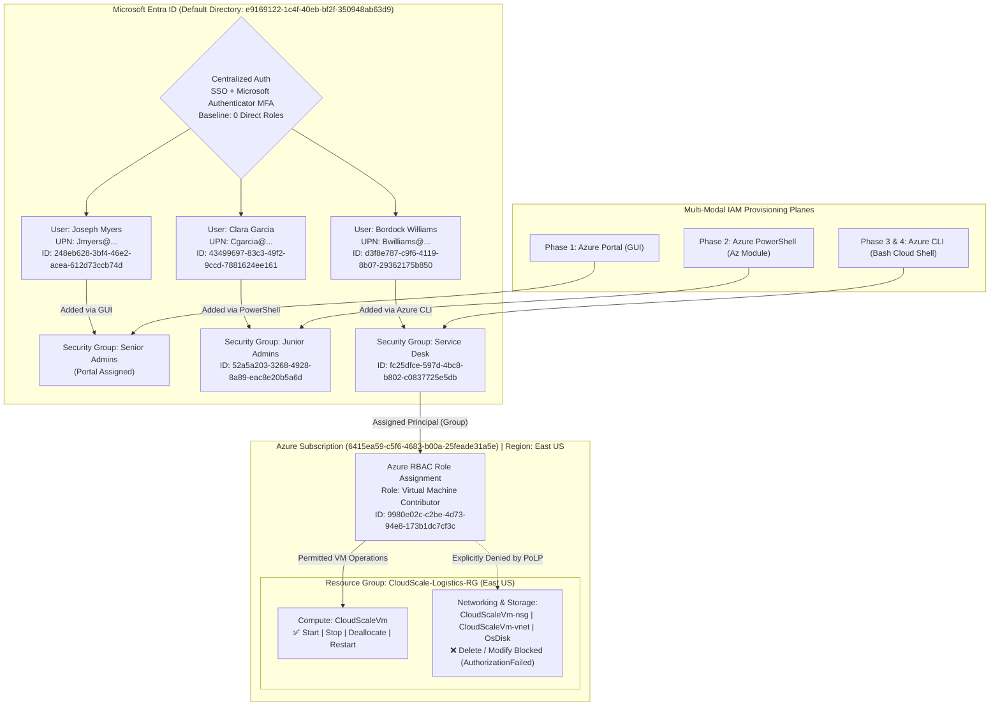

# Implementing Scalable Identity & Access Management (IAM): Cloud-Native RBAC & Lifecycle Automation for CloudScale Logistics


> **Executive Summary:** This project outlines the strategic design and deployment of a Scalable Identity and Access Management (IAM) framework for **CloudScale Logistics** on Microsoft Azure and Microsoft Entra ID. As the organization expands its cloud infrastructure and workforce, legacy access models were modernized through Role-Based Access Control (RBAC) enforcing the Principle of Least Privilege (PoLP), centralized Single Sign-On (SSO) with Multi-Factor Authentication (MFA), and automated identity lifecycle management across the Azure Portal (GUI), Azure PowerShell (`Az` Module), and Azure CLI (Bash). This architecture drastically reduces CloudScale Logistics' internal and external attack surface, eliminates orphaned accounts and permission creep, and lowers IT administrative overhead while providing a frictionless authentication experience.

---

## Table of Contents
- [Tools Used](#tools-used)
- [Skills Learned](#skills-learned)
- [1. Problem Statement & Objectives](#1-problem-statement--objectives)
- [2. Architecture & Design Overview](#2-architecture--design-overview)
- [3. Technology Stack & Tooling](#3-technology-stack--tooling)
- [4. Full Documentation Index](#4-full-documentation-index)
- [5. Implementation Walkthrough](#5-implementation-walkthrough)
  - [Phase 1 (GUI): Utilize the Azure Portal to Create Users, the Senior Admins Group, and Assign Joseph Myers](#phase-1-gui-utilize-the-azure-portal-to-create-users-the-senior-admins-group-and-assign-joseph-myers)
  - [Phase 2 (Scripting): Use PowerShell to Programmatically Create the Junior Admins Group and Assign Clara Garcia](#phase-2-scripting-use-powershell-to-programmatically-create-the-junior-admins-group-and-assign-clara-garcia)
  - [Phase 3 (CLI): Utilize Azure CLI to Create the Service Desk Group and Assign Bordock Williams](#phase-3-cli-utilize-azure-cli-to-create-the-service-desk-group-and-assign-bordock-williams)
  - [Phase 4 (Governance): Assign the Virtual Machine Contributor Role to the Service Desk Group](#phase-4-governance-assign-the-virtual-machine-contributor-role-to-the-service-desk-group)
  - [Phase 5: Resource Decommissioning & Cost Management](#phase-5-resource-decommissioning--cost-management)
- [6. Validation, Testing & Proof of Work](#6-validation-testing--proof-of-work)
- [7. Key Challenges & Trade-Offs](#7-key-challenges--trade-offs)
- [8. Future Enhancements](#8-future-enhancements)
- [9. Reflection & Conclusion](#9-reflection--conclusion)
- [Author & Contact](#author--contact)

---

## Tools Used

**Infrastructure, Cloud & Identity Platforms**  


**Automation, Scripting & Shells**  
-5391FE?style=for-the-badge&logo=powershell&logoColor=white)

-4EAA25?style=for-the-badge&logo=gnubash&logoColor=white)

**Security, Governance & Version Control**  
-0078D4?style=for-the-badge&logo=microsoft&logoColor=white)


---

## Skills Learned

**Architecture & Engineering**  
-Architecture-blue?style=flat-square)

-Access_Control-orange?style=flat-square)

**Security Operations & Governance**  


---

## 1. Problem Statement & Objectives

### Background & Risk / Bottleneck
As **CloudScale Logistics** continues to expand its cloud infrastructure and workforce, its legacy access management practices required modernization to ensure secure, efficient, and auditable identity governance. Relying on manual, ad-hoc "Direct Assignments" (individual user-to-resource permissions) and over-privileged accounts with broad `Owner` rights created severe operational and security bottlenecks:
* **Permission Creep & Lateral Movement Risk:** Individual users granted direct resource permissions or excessive privileges beyond their daily job duties exposed critical logistics infrastructure (virtual networks, storage accounts, and security groups) to accidental deletion or lateral movement.
* **Manual Onboarding & Offboarding Bottlenecks:** Provisioning users and groups exclusively through manual console clicks could not scale during sudden workforce expansions or seasonal logistics surges, while delayed offboarding left behind orphaned accounts.
* **Authentication Vulnerabilities:** Without centralized Single Sign-On (SSO) paired with enforced Multi-Factor Authentication (MFA) and a zero-trust "need-to-know" baseline, workforce accounts remained susceptible to credential-based attacks and password fatigue.

### Core Objectives
* **Objective 1 (Role-Based Access Control & PoLP):** Restructure user permissions across CloudScale Logistics by enforcing the Principle of Least Privilege (PoLP), eliminating direct user-to-resource assignments, and mapping access strictly to security groups aligned with job functions (`Senior Admins`, `Junior Admins`, and `Service Desk`).
* **Objective 2 (Centralized Authentication with SSO & MFA):** Enforce Multi-Factor Authentication (MFA) via Microsoft Authenticator upon initial sign-in and verify that newly provisioned accounts start with zero assigned roles ("need-to-know" baseline) and audited default directory settings.
* **Objective 3 (Multi-Modal Identity Lifecycle Automation):** Demonstrate cross-platform identity provisioning and group management across three management planes—Microsoft Azure Portal (GUI), Windows PowerShell (`Az` module), and Linux-based Azure CLI (`Bash`)—and execute automated offboarding/decommissioning to eliminate orphaned identities and recurring cloud costs.
* **Objective 4 (Granular Infrastructure Governance):** Assign the `Virtual Machine Contributor` role to the `Service Desk` group and empirically verify that members can manage virtual machine lifecycles (`Start`, `Stop`, `Deallocate`, `Restart`) on `CloudScaleVm` while being strictly blocked from deleting or altering underlying Network Security Groups (`CloudScaleVm-nsg`), Virtual Networks, or OS Disks.

> [!IMPORTANT]
> **Scope Note:** This `README.md` is a self-contained engineering case study and operational runbook. It consolidates the complete executive summary, architectural blueprints, step-by-step GUI/PowerShell/CLI workflows, validation logs, and decommissioning procedures without requiring separate `architecture.md`, `setup.md`, or `troubleshooting.md` files.

---

## 2. Architecture & Design Overview

### System Workflow (Mermaid Diagram)



### Key Design Decisions
1. **Group-Based RBAC Over Direct User Assignments:** Rather than assigning permissions directly to individual user objects (`Joseph Myers`, `Clara Garcia`, `Bordock Williams`), all users are provisioned with **zero direct roles** (`No roles assigned`) and placed into job-specific Microsoft Entra ID security groups (`Senior Admins`, `Junior Admins`, `Service Desk`). Role assignments are bound strictly to group Object IDs, ensuring consistent access inheritance and single-step revocation upon department transfer or offboarding.
2. **Multi-Modal Management Plane Validation (GUI + PowerShell + Azure CLI):** To ensure CloudScale Logistics' IAM architecture can be operated across heterogeneous administrator workstations and automation pipelines, group creation and membership binding were validated across all three native interfaces: Azure Portal GUI (`Senior Admins`), Windows PowerShell `Az` module (`Junior Admins`), and Linux-compatible Azure CLI in Bash (`Service Desk`).
3. **Blast-Radius Containment via `Virtual Machine Contributor`:** Assigning `Virtual Machine Contributor` rather than `Contributor` or `Owner` to the `Service Desk` group grants operational staff full authority to restart, start, and deallocate `CloudScaleVm` during support incidents while structurally preventing them from deleting Network Security Groups (`Microsoft.Network/networkSecurityGroups/delete`), modifying virtual networks, or detaching/deleting active OS disks.
4. **Regional Compliance Enforcement (`East US`):** All infrastructure assets are consolidated inside the `CloudScale-Logistics-RG` resource group strictly within the `East US` region to prevent regional compliance violations and enable atomic lifecycle teardown.

---

## 3. Technology Stack & Tooling

### Platform & Tooling Matrix

| Category | Tool / Platform | Role in This Project | Why It Was Chosen |
| :--- | :--- | :--- | :--- |
| **Identity Provider (IdP)** | Microsoft Entra ID | Centralized cloud directory managing users, security groups, default user settings, and MFA | Native integration with Azure RBAC, SSO, and granular directory-level permission controls |
| **Cloud Infrastructure** | Microsoft Azure (`East US`) | Hosts `CloudScale-Logistics-RG`, `CloudScaleVm`, `CloudScaleVm-vnet`, `CloudScaleVm-nsg`, and disks | Enforces regional compliance boundaries and resource-level activity logging |
| **Web Management Plane** | Azure Portal & Entra Admin Center | Phase 1 GUI provisioning, permission creep auditing, and Phase 4 RBAC validation | Provides visual verification of directory settings, MFA registration, and Activity Logs |
| **Windows Automation** | Azure PowerShell (`Az` Module) | Phase 2 programmatic creation of `Junior Admins` and assignment of `Clara Garcia` | Enables repeatable Windows-based identity onboarding automation via Microsoft Graph/Az cmdlets |
| **Cross-Platform CLI** | Azure CLI (`az ad` / `az role`) | Phase 3 `Service Desk` creation, Phase 4 RBAC role assignment, and Phase 5 teardown | Compatible with Linux/Bash environments for cross-platform scripting and CI/CD pipelines |
| **Authentication Security** | Microsoft Authenticator (MFA) | Enforces multi-factor QR enrollment on initial user sign-in (`my-signins`) | Neutralizes credential stuffing and phishing attacks while reducing password fatigue |

### Identity, Group & RBAC Inventory

| User Display Name | User Principal Name (UPN) | User Object ID | Assigned Security Group | Group Object ID | Provisioning Plane | Assigned RBAC Role |
| :--- | :--- | :--- | :--- | :--- | :--- | :--- |
| **Joseph Myers** | `Jmyers@chinazannamani6060gmail.onmicrosoft.com` | `248eb628-3bf4-46e2-acea-612d73ccb74d` | `Senior Admins` | *(Portal Managed)* | Azure Portal (GUI) | Baseline Verified (`No roles assigned` directly) |
| **Clara Garcia** | `Cgarcia@chinazannamani6060gmail.onmicrosoft.com` | `43499697-83c3-49f2-9ccd-7881624ee161` | `Junior Admins` | `52a5a203-3268-4928-8a89-eac8e20b5a6d` | Azure PowerShell (`Az`) | Baseline Verified (`Department: Admin`) |
| **Bordock Williams** | `Bwilliams@chinazannamani6060gmail.onmicrosoft.com` | `d3f8e787-c9f6-4119-8b07-29362175b850` | `Service Desk` | `fc25dfce-597d-4bc8-b802-c0837725e5db` | Azure CLI (`Bash`) | `Virtual Machine Contributor` (Inherited via Group) |

---

## 4. Full Documentation Index

All project documentation, command scripts, and empirical validation proofs are consolidated directly inside this `README.md`. Below is the repository directory layout and section guide:

```text
scalable-iam-project/
├── assets/
│   └── images/                              # Step-by-step Azure Portal, PowerShell, and Cloud Shell screenshots
├── docs/
│   └── implementing_scalable_IAM.pdf        # Original PDF implementation report for CloudScale Logistics
├── .gitignore                               # Excludes temporary OS files (.DS_Store, Thumbs.db, .tmp)
└── README.md                                # Complete self-contained engineering case study & runbook
```

| Section | Focus Area & Deliverables |
| :--- | :--- |
| [**Phase 1: GUI Provisioning & Permission Audit**](#phase-1-gui-utilize-the-azure-portal-to-create-users-the-senior-admins-group-and-assign-joseph-myers) | `CloudScale-Logistics-RG` creation in `East US`, Entra ID user provisioning, Member permission creep audit, MFA QR setup, and `Senior Admins` group assignment. |
| [**Phase 2: PowerShell Identity Automation**](#phase-2-scripting-use-powershell-to-programmatically-create-the-junior-admins-group-and-assign-clara-garcia) | Installing the `Az` PowerShell module, authenticating via `Connect-AzAccount`, creating `Junior Admins`, and programmatically assigning `Clara Garcia`. |
| [**Phase 3: Azure CLI Cross-Platform Onboarding**](#phase-3-cli-utilize-azure-cli-to-create-the-service-desk-group-and-assign-bordock-williams) | Querying user Object IDs with JMESPath (`--query "[0].id"`), creating the `Service Desk` group via `az ad group create`, and adding `Bordock Williams`. |
| [**Phase 4: RBAC Governance & Least-Privilege Testing**](#phase-4-governance-assign-the-virtual-machine-contributor-role-to-the-service-desk-group) | Binding `Virtual Machine Contributor` to `Service Desk`, validating VM `Start`/`Deallocate`/`Restart` rights, and proving `AuthorizationFailed` on NSG/Disk deletion. |
| [**Phase 5: Decommissioning & Cost Management**](#phase-5-resource-decommissioning--cost-management) | Asynchronous infrastructure teardown (`--yes --no-wait`) and purging of test groups and user accounts to prevent recurring costs and orphaned identities. |

---

## 5. Implementation Walkthrough

### Phase 1 (GUI): Utilize the Azure Portal to Create Users, the Senior Admins Group, and Assign Joseph Myers
**Environment:** Microsoft Azure Portal & Microsoft Entra Admin Center

**Objectives:**
* In Microsoft Entra ID, create user accounts for **Joseph Myers**, **Clara Garcia**, and **Bordock Williams**.
* Audit the environment for "Direct Assignments" (individual user-to-resource permissions) and identify accounts with `Owner` rights that exceed their daily duties.
* Ensure all identities are functional before applying group logic.
* Create a security group named **Senior Admins** and add **Joseph Myers** as a member using the Portal interface.

This phase validates the foundational identity management process using the native web interface:

1. **Provision Regional Resource Group:** On the Azure Portal, we created a Resource Group named `CloudScale-Logistics-RG` strictly within the `East US` region. This prevents regional compliance violations and ensures that all resources associated with CloudScale Logistics are created and stored within a single governed region.


*Figure 1: Provisioning the `CloudScale-Logistics-RG` resource group strictly within the `East US` region under `Azure subscription 1`.*

2. **Provision Workforce Identities in Microsoft Entra ID:** We navigated to Microsoft Entra ID via the Azure Portal and provisioned the user accounts for **Joseph Myers** (`Jmyers@chinazannamani6060gmail.onmicrosoft.com`), **Clara Garcia** (`Cgarcia@chinazannamani6060gmail.onmicrosoft.com`), and **Bordock Williams** (`Bwilliams@chinazannamani6060gmail.onmicrosoft.com`).


*Figure 2: Microsoft Entra admin center displaying the newly provisioned Member accounts for Bordock Williams, Clara Garcia, and Joseph Myers.*

3. **Permission Creep Audit:** New users in Microsoft Entra ID do not have any administrative roles (such as `Global Administrator` or `User Administrator`) attached to them by default. However, by default, Entra ID provisions new internal accounts as **Member** users. Member users immediately inherit a baseline set of read and write privileges across the directory—they can:
   * **Read the Directory**
   * **Register Applications** (`Users can register applications: Yes`)
   * **Create Security Groups** (`Users can create security groups: Yes`)
   * **Invite External Guests** (governed under *Guest user access restrictions*)
   * **Manage Their Own Profile**


*Figure 3: Auditing default user role permissions and guest user access restrictions under `Users | User settings` in Microsoft Entra ID.*

4. **Zero-Trust Baseline & MFA Verification:** We verified that all three users can authenticate—enforcing Multi-Factor Authentication (MFA) enrollment via the Microsoft Authenticator app—while confirming they currently possess **zero access to resources** (`No roles assigned`), establishing the "need-to-know" foundational security model.


*Figure 4: Enforcing Multi-Factor Authentication (MFA) registration via Microsoft Authenticator QR code during initial login for `Jmyers@chinazannamani6060gmail.onmicrosoft.com`.*


*Figure 5: Authenticated session for Joseph Myers (`248eb628-3bf4-46e2-acea-612d73ccb74d`) in Tenant `e9169122-1c4f-40eb-bf2f-350948ab63d9` confirming `No roles assigned` by default.*

5. **Create `Senior Admins` Group & Assign Member:** We created the security group labeled **Senior Admins** and manually assigned the **Joseph Myers** user object to the security group using the portal's graphical assignment flow.


*Figure 6: Verifying Joseph Myers as a direct member of the `Senior Admins` security group in the Microsoft Entra admin center.*

---

### Phase 2 (Scripting): Use PowerShell to Programmatically Create the Junior Admins Group and Assign Clara Garcia
**Environment:** Azure PowerShell (`Az` Module)

**Objectives:**
* Use PowerShell to create the **Junior Admins** security group and assign **Clara Garcia**, validating the ability to scale identity onboarding via Windows automation.

This phase transitions from manual GUI deployment to programmatic execution using native Windows PowerShell automation:

1. **Launch PowerShell & Authenticate to Azure:** We launched a standardized Windows PowerShell environment, installed the `Az` module from `PSGallery` scoped to `CurrentUser`, and authenticated to the tenant using `Connect-AzAccount`.


*Figure 7: Installing the `Az` PowerShell module (`Install-Module -Name Az -Repository PSGallery -Force -Scope CurrentUser`) and authenticating to `Azure subscription 1` (`Default Directory`) via `Connect-AzAccount`.*

2. **Instantiate the `Junior Admins` Security Group:** We retrieved Clara Garcia's user object (`Id: 43499697-83c3-49f2-9ccd-7881624ee161`) and instantiated the **Junior Admins** security group (`Id: 52a5a203-3268-4928-8a89-eac8e20b5a6d`, `MailNickname: JuniorAdmins`, `SecurityEnabled: True`).


*Figure 8: Retrieving Clara Garcia's user object and creating the `Junior Admins` security group (`52a5a203-3268-4928-8a89-eac8e20b5a6d`) via `New-AzADGroup`.*

3. **Assign Group Membership & Verify Population:** We passed the user Object ID (`43499697-83c3-49f2-9ccd-7881624ee161`) and target group Object ID (`52a5a203-3268-4928-8a89-eac8e20b5a6d`) into `Add-AzADGroupMember` and verified the membership assignment using `Get-AzADGroupMember`.


*Figure 9: Adding Clara Garcia to `Junior Admins` via `Add-AzADGroupMember` and verifying membership properties (`CompanyName: CloudScale Logistics`, `Department: Admin`) with `Get-AzADGroupMember`.*

<details>
<summary><strong>Click to expand: PowerShell Commands Used (Phase 2)</strong></summary>

```powershell
# Install Az module
Install-Module -Name Az -Repository PSGallery -Force -Scope CurrentUser

# Authenticate to the Azure portal
Connect-AzAccount

# Get user object and store in "user" variable
$user = Get-AzADUser -DisplayName "Clara Garcia"

# Create group and store object in "group" variable
$group = New-AzADGroup -DisplayName "Junior Admins" -MailNickname "JuniorAdmins"

# Add user "Garcia" to group
Add-AzADGroupMember -TargetGroupObjectId $group.Id -MemberObjectId $user.Id

# Verify that "Garcia" has been added to "Junior Admins" group
Get-AzADGroupMember -GroupObjectId $group.Id
```

</details>

---

### Phase 3 (CLI): Utilize Azure CLI to Create the Service Desk Group and Assign Bordock Williams
**Environment:** Azure CLI (Azure Cloud Shell – Bash)

**Objectives:**
* Execute Azure CLI commands to create the **Service Desk** security group and add **Bordock Williams**, completing the creation of the three distinct security groups and validating compatibility with Linux-based management environments.

This phase validates cross-platform management capabilities in a Bash environment:

1. **Retrieve User Object ID & Create Security Group:** Using Azure Cloud Shell, we queried Bordock Williams' existing Object ID (`d3f8e787-c9f6-4119-8b07-29362175b850`) using JMESPath (`--query "[0].id" --output tsv`), created the **Service Desk** security group (`fc25dfce-597d-4bc8-b802-c0837725e5db`) without appending invalid OData filtering parameters, and assigned Bordock Williams to the group via `az ad group member add`.


*Figure 10: Retrieving Bordock Williams' Object ID (`d3f8e787-c9f6-4119-8b07-29362175b850`), creating the `Service Desk` group (`fc25dfce-597d-4bc8-b802-c0837725e5db`), and adding the member in Azure Cloud Shell.*

2. **Verify Group Membership Population:** We queried the group membership list using `az ad group member list --group fc25dfce-597d-4bc8-b802-c0837725e5db` and confirmed the JSON response returned Bordock Williams (`jobTitle: "Service Desk"`, `userPrincipalName: "Bwilliams@chinazannamani6060gmail.onmicrosoft.com"`).


*Figure 11: Querying `az ad group member list` to confirm Bordock Williams is populated inside the `Service Desk` security group.*

<details>
<summary><strong>Click to expand: Azure CLI Commands Used (Phase 3)</strong></summary>

```bash
# 1. Retrieve Bordock's Object ID
userId=$(az ad user list --display-name "Bordock Williams" --query "[0].id" --output tsv)

# 2. Create the "Service Desk" Security Group and grab its ID
groupId=$(az ad group create --display-name "Service Desk" --mail-nickname "ServiceDesk" --security-enabled true --mail-enabled false --query "id" --output tsv)

# 3. Add Bordock to the newly created group
az ad group member add --group "$groupId" --member-id "$userId"

# 4. Verify that Bordock is a member of the group
az ad group member list --group "$groupId"
```

</details>

---

### Phase 4 (Governance): Assign the Virtual Machine Contributor Role to the Service Desk Group
**Environment:** Azure CLI / Microsoft Azure Portal

**Objectives:**
* Assign the **Virtual Machine Contributor** role to the **Service Desk** group and validate that members can manage VM lifecycles (`Start`, `Stop`, `Deallocate`, `Restart`) while remaining strictly restricted from altering virtual networks, modifying storage accounts, or deleting parent infrastructure.

This phase maps directory identities to tangible infrastructure permissions using Azure's Role-Based Access Control (RBAC) model:

1. **Bind RBAC Role to the `Service Desk` Group Object ID:** We fetched the `Service Desk` group Object ID (`fc25dfce-597d-4bc8-b802-c0837725e5db`) and active Subscription ID (`6415ea59-c5f6-4683-b00a-25feade31a5e`), then executed `az role assignment create` to bind the built-in `Virtual Machine Contributor` role (`9980e02c-c2be-4d73-94e8-173b1dc7cf3c`) to the `Service Desk` group principal.


*Figure 12: Assigning the `Virtual Machine Contributor` role to the `Service Desk` group Object ID (`fc25dfce-597d-4bc8-b802-c0837725e5db`) via `az role assignment create`.*


*Figure 13: Confirming the `Virtual Machine Contributor` role assignment via JSON output and `az role assignment list --assignee "$groupId" --all --output table`.*

2. **Validate Permitted VM Lifecycle Operations (`Start`, `Deallocate`, `Restart`):** Signing into the Azure Portal as **Bordock Williams** (`Bwilliams@chinazannamani6060gmail.onmicrosoft.com`), we navigated to `CloudScale-Logistics-RG` -> `CloudScaleVm` and executed **Deallocate**, **Start**, and **Restart** operations. The `CloudScaleVm | Activity log` confirmed all three operations were accepted and succeeded under Bordock Williams' identity.


*Figure 14: `CloudScaleVm | Activity log` proving Bordock Williams (`Bwilliams@...`) successfully executed `Deallocate Virtual Machine`, `Start Virtual Machine`, and `Restart Virtual Machine` via inherited `Service Desk` group permissions.*

3. **Verify Least-Privilege Restrictions on Networking & Storage Deletion:** While still authenticated as **Bordock Williams**, we attempted to delete the attached OS Disk (`CloudScaleVm_OsDisk_1_ad57377f6245046bf86243b92626c57d`) and the Network Security Group (`CloudScaleVm-nsg`) inside `CloudScale-Logistics-RG`. Azure RBAC immediately blocked the actions, throwing `Code: OperationNotAllowed` on the attached disk and `AuthorizationFailed` (`does not have authorization to perform action 'Microsoft.Network/networkSecurityGroups/delete'`) on `CloudScaleVm-nsg`.


*Figure 15: Empirical proof of Principle of Least Privilege (PoLP)—Bordock Williams is blocked from deleting `CloudScaleVm-nsg` (`Microsoft.Network/networkSecurityGroups/delete` denied) and `CloudScaleVm_OsDisk_1`.*

<details>
<summary><strong>Click to expand: Azure CLI Commands Used to Assign Role (Phase 4)</strong></summary>

```bash
# 1. Fetch the Service Desk group's Object ID
groupId=$(az ad group list --display-name "Service Desk" --query "[0].id" --output tsv)

# 2. Fetch the current active Subscription ID
subId=$(az account show --query "id" --output tsv)

# 3. Create the Role Assignment at the Subscription scope
az role assignment create \
  --assignee-object-id "$groupId" \
  --assignee-principal-type Group \
  --role "Virtual Machine Contributor" \
  --scope "/subscriptions/$subId"

# 4. Verify that the assignment was successfully applied
az role assignment list --assignee "$groupId" --all --output table
```

</details>

---

### Phase 5: Resource Decommissioning & Cost Management
**Environment:** Azure CLI (Azure Cloud Shell – Bash)

**Objectives:**
* Use the Azure CLI to delete `CloudScale-Logistics-RG` and all associated test resources, and remove the test users (`Joseph Myers`, `Clara Garcia`, `Bordock Williams`) and security groups (`Service Desk`, `Senior Admins`, `Junior Admins`) so no recurring costs or orphaned identities remain in the tenant.

This operational phase ensures the complete and secure removal of all test assets:
* Purged the Entra ID security groups (`Service Desk`, `Senior Admin`, and `Junior Admin`) to prevent orphaned directory objects.
* Executed the deletion of the Infrastructure Resource Group (`CloudScale-Logistics-RG`) utilizing the `--yes` and `--no-wait` parameters to immediately halt recurring compute and storage costs while bypassing terminal locking during destruction.
* Deleted the individual test user identities (`Bwilliams@...`, `Cgarcia@...`, and `Jmyers@...`).


*Figure 16: Executing automated teardown of security groups, `CloudScale-Logistics-RG` (`--yes --no-wait`), and test user accounts in Azure Cloud Shell.*

<details>
<summary><strong>Click to expand: Azure CLI Decommissioning Commands Used (Phase 5)</strong></summary>

```bash
# Delete groups
az ad group delete --group "Service Desk"
az ad group delete --group "Senior Admin"
az ad group delete --group "Junior Admin"

# Delete the Resource group
az group delete --name "CloudScale-Logistics-RG" --yes --no-wait

# Delete users
az ad user delete --id "Bwilliams@chinazannamani6060gmail.onmicrosoft.com"
az ad user delete --id "Cgarcia@chinazannamani6060gmail.onmicrosoft.com"
az ad user delete --id "Jmyers@chinazannamani6060gmail.onmicrosoft.com"
```

</details>

---

## 6. Validation, Testing & Proof of Work

To verify that the implementation met all security, scalability, and governance objectives, the following test scenarios were executed across the tenant:

### Baseline vs. Post-Implementation Results

| Metric / Test Scenario | Baseline (Before) | Post-Implementation (After) | Status |
| :--- | :--- | :--- | :--- |
| **Test 1: Direct User Permission Creep Audit** | Ad-hoc direct assignments & over-privileged `Owner` accounts | New users provisioned with `No roles assigned`; default `Member` directory settings audited | **Passed** |
| **Test 2: Workforce MFA & SSO Enforcement** | Single-factor password authentication susceptible to phishing | Enforced Microsoft Authenticator QR registration on initial sign-in | **Passed** |
| **Test 3: Multi-Modal Group Onboarding** | Manual GUI-only group management | Validated across Portal GUI (`Senior Admins`), PowerShell (`Junior Admins`), and Azure CLI (`Service Desk`) | **Passed** |
| **Test 4: Authorized VM Lifecycle Management** | Required broad `Contributor`/`Owner` rights to manage VMs | `Service Desk` member (`Bordock Williams`) executed `Deallocate`, `Start`, and `Restart` on `CloudScaleVm` | **Passed** |
| **Test 5: Unauthorized Network/Disk Deletion Attempt** | Unconstrained deletion risk across resource group | Blocked with `AuthorizationFailed` on `CloudScaleVm-nsg` and `OperationNotAllowed` on OS Disk | **Passed** |
| **Test 6: Automated Offboarding & FinOps Teardown** | Orphaned accounts and lingering compute/storage billing | Purged all 3 groups, 3 users, and `CloudScale-Logistics-RG` (`--yes --no-wait`) via Azure CLI | **Passed** |

---

## 7. Key Challenges & Trade-Offs

> [!NOTE]
> Documenting operational roadblocks and how they were resolved during deployment provides a practical reference for cloud security engineers managing Microsoft Entra ID and Azure RBAC.

* **Challenge 1: Hidden Baseline Privileges on Default Entra ID "Member" Accounts**
  * *Issue:* While new users in Microsoft Entra ID have zero administrative roles attached by default, auditing `Users | User settings` revealed that standard `Member` accounts inherit default directory write privileges—specifically `Users can register applications = Yes` and `Users can create security groups = Yes`.
  * *Resolution:* Documented the default `Member` permission baseline during the Phase 1 Permission Creep Audit so security governance policies can restrict non-admin application registration and group creation in production tenants.
* **Challenge 2: PowerShell `New-AzADGroup` Positional Parameter & Preview API Behavior**
  * *Issue:* Running `New-AzADGroup -DisplayName "Junior Admins" -MailNickname "JuniorAdmins" -SecurityEnabled $true` in Windows PowerShell threw `New-AzADGroup : A positional parameter cannot be found that accepts argument 'True'`, and `Add-AzADGroupMember` / `Get-AzADGroupMember` emitted preview API warnings.
  * *Resolution:* Removed the redundant `$true` positional argument (as `New-AzADGroup` creates security-enabled groups by default when `-MailNickname` and `-DisplayName` are provided) and passed the explicit Object IDs (`52a5a203-3268-4928-8a89-eac8e20b5a6d` and `43499697-83c3-49f2-9ccd-7881624ee161`) to complete and verify the group assignment.
* **Challenge 3: Ephemeral Azure Cloud Shell Sessions & Clean Object ID Extraction**
  * *Issue:* Azure Cloud Shell sessions can time out or reconnect between commands, and appending invalid OData filter flags to `az ad` commands can break script execution.
  * *Resolution:* Used native JMESPath queries (`--query "[0].id" --output tsv` and `--query "id" --output tsv`) to cleanly capture raw GUIDs into shell variables (`$userId`, `$groupId`, `$subId`) and verified persistence with `az ad group member list` and `az role assignment list`.
* **Challenge 4: Operational Autonomy vs. Blast-Radius Containment**
  * *Issue:* Service Desk analysts require daily operational control over virtual machines (`CloudScaleVm`) to resolve availability incidents, but granting standard `Contributor` access would allow them to delete virtual networks (`CloudScaleVm-vnet`) or Network Security Groups (`CloudScaleVm-nsg`).
  * *Resolution:* Scoped the `Service Desk` group strictly to the built-in `Virtual Machine Contributor` role, which permitted VM `Start`, `Deallocate`, and `Restart` actions while explicitly denying `Microsoft.Network/networkSecurityGroups/delete`.

---

## 8. Future Enhancements

- [ ] **Microsoft Entra Privileged Identity Management (PIM):** Transition the `Senior Admins` group from standing access to Just-in-Time (JIT) eligible role assignments requiring approval, justification, and time-bound activation.
- [ ] **Hardened Default User Settings & Conditional Access:** Toggle `Users can register applications` and `Users can create security groups` to `No` for standard members, and enforce Conditional Access policies requiring compliant devices and phishing-resistant MFA.
- [ ] **Dynamic Membership Rules & HR-Driven Provisioning:** Convert `Senior Admins`, `Junior Admins`, and `Service Desk` from assigned groups to Dynamic User Groups driven by Entra ID user attributes (e.g., `user.department -eq "Service Desk"` and `user.jobTitle -eq "Service Desk"`).
- [ ] **GitOps IAM with Terraform (`azuread` & `azurerm`):** Codify Entra ID groups, users, and Azure RBAC role assignments into version-controlled Terraform modules with CI/CD policy gating.

---

## 9. Reflection & Conclusion

This Proof of Concept successfully demonstrated that Azure Identity and Access Management is highly adaptable across varied environments. The **Azure Portal** provided a visual baseline for initial configurations and permission creep auditing, while **PowerShell** introduced vital automation for scalable user onboarding. Finally, utilizing the **Azure CLI in Bash** validated cross-platform flexibility, proving that Linux environments can natively manage Microsoft Entra ID objects and role assignments.

Beyond identity creation, implementing **Role-Based Access Control (RBAC)** was a critical success. By assigning the `Virtual Machine Contributor` role to the `Service Desk` group, this workflow enforced the **Principle of Least Privilege (PoLP)**. This allowed essential operational control over VM lifecycles (`Start`, `Deallocate`, `Restart`) while strictly denying access to underlying storage and virtual networks (`CloudScaleVm-nsg`), minimizing potential security risks and protecting CloudScale Logistics' critical cloud infrastructure.

---

## Author & Contact

**Chinaza Nnamani**  
App/Cloud Security Consultant | Cybersecurity & Cloud Governance  
* **GitHub:** [@ch1n4x4](https://github.com/ch1n4x4)
* **LinkedIn:** [linkedin.com/in/chinaza-nnamani](https://linkedin.com/in/chinaza-nnamani)